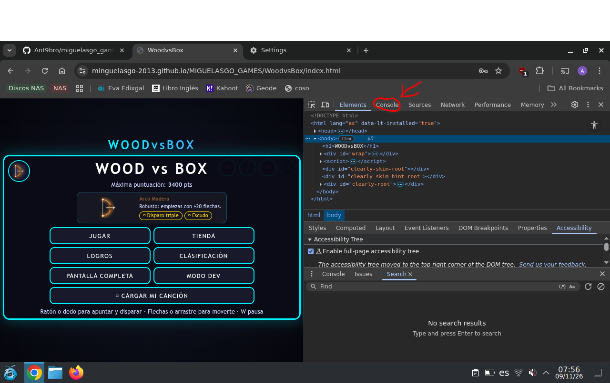
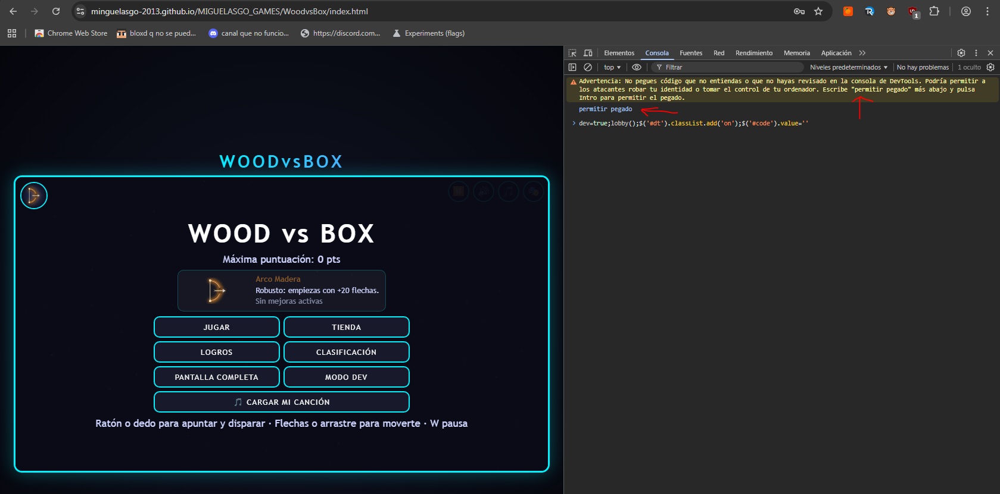

# miguelasgo_games-cheats
Trampas/hacks para juegos en MIGUESLASGO GAMES https://minguelasgo-2013.github.io/MIGUELASGO_GAMES/

Estos son hacks/trampas para  algunos juegos en la plataforma MIGUELASGO GAMES. Por ahora hay pocos pero iré añadiendo más.

# Como usarlos (en Google Chrome)
Lo primero, ve al código del hack que quieras usar y cópialo. 

Después, ve al juego correspondiente y abre DevTools presionando F12 o Ctrl+Shift+I. Ve a la Consola, en la barra de arriba.

Pega el script que previamente copiaste y ejecútalo. Es probable que dé error por pegar código, pero solo tienes que poner el comando que te dice y volver a pegar el hack. Presiona Enter/Intro y listo.

